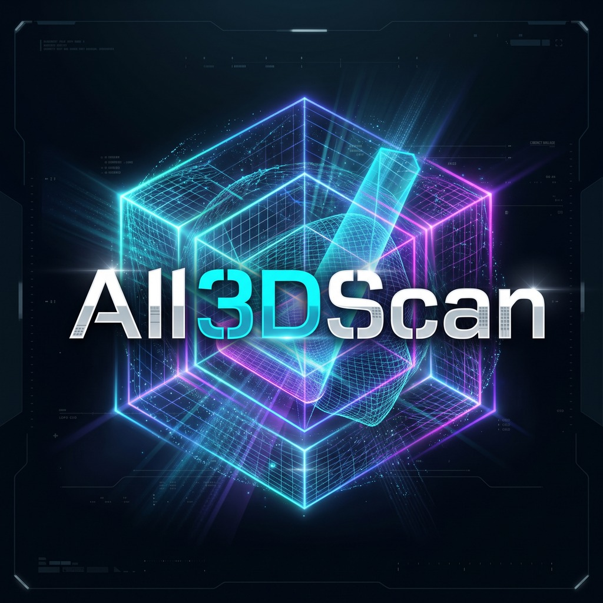

<p align="center">
  
</p>

# All3DScan — Open-Source Native Linux 3D Scanning App
[Project Still Under-Development]

A clean-room, open-source **native** Linux scanning application with a dark
interface, targeting consumer structured-light 3D scanners
from **Revopoint, Creality, and Einstar**. So far, live scanning is being
developed on the **Revopoint POP 4** only, and is still in development there
(see [Supported hardware](#supported-hardware)).
This is **not** a Wine wrapper:
it talks to the scanner through Linux's own USB (`uvcvideo`/`hidraw`) and GPU
stacks. Wine often fails to expose these scanners and cannot drive their
Direct3D/CUDA paths reliably — that is exactly why this project exists.

None of these vendors ship a Linux build of their scanning software, so this
project reverse-engineers each scanner's USB protocol directly. The app is a
PyQt6 window over a Rust processing engine, which drives the scanner through a
C++ layer (see [How it is built](#how-it-is-built)). It is developed and
tested on CachyOS (Arch-based) with an NVIDIA RTX 2060. Other distributions
should work, but have not been tried.

## Supported hardware

**Any scanner, for everything after the scan.** All3DScan opens and saves
`.ply`, `.obj`, `.stl`, `.pcd`, `.asc`, `.xyz`, `.pts`, `.txt` and `.p3`, so a
scan exported by any scanner gets the full toolchain — cleaning, meshing,
plane and cylinder fitting, STEP — whether or not its live protocol is
implemented. **File → Open scan** (Ctrl+O), **File → Save scan as** (Ctrl+S).

Third-party code lives in `third_party/`, each with its own licence and a
`NOTICE.md` saying where it came from and what has been checked. There is
one: a subset of [PoissonRecon](https://github.com/mkazhdan/PoissonRecon)
(BSD-3-Clause), which fits a surface through a point cloud that has no depth
views behind it.

**Live capture** is per-device, because each vendor's USB protocol has to be
reverse-engineered with the hardware in hand. Device IDs live in
`resources/devices.json` and are matched at runtime, so new models can be
added without recompiling. Entries may match a specific product or an entire
vendor.

See [`docs/HARDWARE_SUPPORT.md`](docs/HARDWARE_SUPPORT.md) for the
evidence-based compatibility matrix. Detection does not imply that capture,
calibration, projector control, or reconstruction is implemented.

**Live scanning is in development, on the Revopoint POP 4 only.** The POP 4
can take a scan, but it is still being developed. Every other scanner below
is recognised when plugged in and named in the scanner list, but cannot take
a scan yet. Scan with the vendor's own software, then open the export here with
**File → Open scan**.

| Scanner | USB ID | Live scanning |
| --- | --- | --- |
| Revopoint POP 4 | `2207:110c` | 🚧 **In development.** Scans in infrared mode: lights, exposure, factory calibration, tracking, live mesh. Still to come: blue-laser scanning, marker tracking, and more reliable tracking and depth on dark or plain objects. |
| Revopoint POP / POP 2 / POP 3 / MINI / RANGE | vendor `2207` | ❌ **Not working yet.** Not tested; no protocol work done. |
| Creality CR-Scan Otter | `2bc5:06da` | ❌ **Not working yet.** Recognised on USB; no capture protocol. |
| Creality CR-Scan Ferret / Ferret Pro / Raptor | vendor `2bc5` | ❌ **Not working yet.** Recognised on USB; no capture protocol. |
| Einstar / Shining3D | not confirmed\* | ❌ **Not working yet.** Detection is off until a real `lsusb` confirms the ID. |

\* The Einstar Rockit was reported as `2207:2001` in
[issue #2](https://github.com/BR1ZB3AR/All3DScan/issues/2), with a protocol
description that has not been tested here. To add an Einstar, attach it, run
`lsusb`, set the real `vendorId` in `resources/devices.json`, and set
`"enabled": true`.

## Status

### What works on the POP 4 so far

- **Aiming.** The depth and colour cameras are live as soon as the scanner
  connects. A distance gauge shows how far away the surface is.
- **The scanner's own controls.** The pattern projector; the white light,
  which flashes while a scan runs; and the depth exposure, with an **Auto**
  button that finds the exposure giving the most depth.
- **Its factory calibration.** On connecting, the app reads the scanner's own
  calibration files (read-only). Depth comes out in true millimetres, and
  each point takes the colour the colour camera sees there.
- **Tracking and fusion.** Each frame is aligned onto the model built so far
  and merged into it. The status bar shows how many frames were placed.
- **Live mesh.** A rough surface is shown in place of the points while you
  scan, so you can see what has been covered while there is still time to go
  back.
- **Show the scan on the camera.** The scan is drawn over the colour camera's
  picture through the factory calibration. Where it sits off the object, the
  scan is off too.
- **After a scan:** **Isolation** removes the surface the object stands on and
  the room around it. **Mesh** builds one closed surface. **Fit plane** and
  **Fit cylinder** feed **Export STEP**, which writes exact CAD geometry.
- **Scan modes:** Infrared (the one that scans), Blue laser (visible), and
  Infrared speckle. Leaving blue laser or speckle restarts the scanner, about
  45 s.

### Still in development

- **Tracking uses only the shape of the surface.** A flat or symmetrical
  scene, such as a ball on a mat, can slide or lose track. **Marker scan** and
  **Global marker** only choose the scanning preset for now; tracking by
  markers is being built.
- **Depth coverage is low.** Only a few percent of the depth camera's pixels
  get a depth on the scenes measured so far. Dark, shiny or plain objects
  give very little.
- **Blue-laser mode projects, but cannot scan.** It needs its own line-laser
  decoder, and by Revopoint's own FAQ, markers.
- **Overlap, Smooth, Simplify and Fill holes** are placeholders.

Every measurement behind this is logged in [`docs/WORK_LOG.md`](docs/WORK_LOG.md)
(the app) and [`docs/protocol/RE_NOTES.md`](docs/protocol/RE_NOTES.md) (the
scanner's protocol).

## Install and run

### What you need

On Arch or CachyOS (tested):

```sh
sudo pacman -S --needed base-devel git rust python pkgconf libusb libjpeg-turbo
sudo pacman -S --needed cuda   # optional: decodes depth on an NVIDIA GPU
```

On Ubuntu or Debian (untested):

```sh
sudo apt-get install -y build-essential git pkg-config python3-venv \
    libusb-1.0-0-dev libturbojpeg0-dev
```

plus Rust 1.88 or newer from [rustup.rs](https://rustup.rs). Distribution
packages of Rust are often older than that.

`libusb` is what reaches the POP 4; without it, the app builds without
scanner support. Without `libturbojpeg`, scans have no colour. Without CUDA,
depth is decoded on the CPU, which is slower.

### Build and run

```sh
git clone https://github.com/BR1ZB3AR/All3DScan.git
cd All3DScan
python3 -m venv .venv
.venv/bin/pip install maturin
.venv/bin/maturin develop --release   # builds the engine and installs it, with PyQt6 and the rest
.venv/bin/python gui_python/app.py
```

Run `maturin` from the repository root. Run from `engine_rust/`, it installs a
second, conflicting package.

```sh
.venv/bin/python gui_python/app.py --mock          # also offer a stand-in camera, to try the app without a scanner
.venv/bin/python gui_python/app.py --smoke-test    # scan, complete, fit, export STEP, then exit
.venv/bin/python gui_python/install_desktop_entry.py  # add All3DScan to the app launcher
```

Tests, none of which need a scanner:

```sh
.venv/bin/python -m unittest discover -s gui_python/tests
.venv/bin/python -m unittest discover -s engine_rust/tests
(cd engine_rust && cargo test --release)
```

## USB device permissions

Install the udev rules so the app can access the scanner without root:
```sh
sudo cp resources/70-all3dscan-scanners.rules /etc/udev/rules.d/
sudo udevadm control --reload-rules && sudo udevadm trigger
```

## How it is built

| Part | Language | What it does |
| --- | --- | --- |
| `gui_python/` | Python, PyQt6 | The window, laid out like Revo Scan 6 |
| `engine_rust/` | Rust (PyO3, cxx) | The engine the window imports as `all3dscan_engine`: fusion, live mesh and meshing, isolation, plane and cylinder fitting, file formats |
| `hw_cpp/` | C++ | The scanner layer: drives the POP 4 through the backend in `src/` |
| `fusion_cpp/`, `mesh_cpp/` | C++ | Frame alignment and surface reconstruction, wrapping `src/processing` and `src/geometry` |
| `src/` | C++ | The older Qt app (below). The engine reuses its scanner backend (`src/usb`, `src/protocol`, `src/decoder`) and its reconstruction |
| `third_party/PoissonRecon/` | C++ | Fits a surface through a cloud that has no depth views behind it |
| `tools/re_probe/` | Python | USB, extension-unit and HID protocol analysis and replay tools |
| `docs/` | | [`WORK_LOG.md`](docs/WORK_LOG.md), [`protocol/RE_NOTES.md`](docs/protocol/RE_NOTES.md), [`HARDWARE_SUPPORT.md`](docs/HARDWARE_SUPPORT.md) |

STEP export uses OpenCASCADE, through the `cadquery-ocp` wheel.

## The older C++/Qt app

The project began as a C++/Qt5 app, in `src/`. New work goes into the window
above, but the older app still builds. The CI workflow builds and tests it,
and `tools/package_linux.sh` packages it. It has one thing the new window does
not yet: **File → Merge Scan…**, for joining scans captured separately, also
available as `all3dscan --merge-scans a.ply b.ply out.ply`.

Build it on Ubuntu or Debian:

```sh
sudo apt-get install -y build-essential cmake qtbase5-dev qt5-qmake \
    libqt5opengl5-dev libusb-1.0-0-dev catch2 nlohmann-json3-dev
cmake -B build -S .
cmake --build build -j
./build/all3dscan                         # the POP 4
ALL3DSCAN_BACKEND=mock ./build/all3dscan  # a synthetic scanner, no hardware
./build/all3dscan --probe-pop4            # arm the POP 4 and capture, without the window
cd build && ctest --output-on-failure     # its tests
```

Its tracking can be tuned with `ALL3DSCAN_TRACK_MIN_OVERLAP` (default 0.30),
`ALL3DSCAN_TRACK_TOLERANCE_MM` (4) and `ALL3DSCAN_TRACK_MAX_RMSE_MM` (2.5).
`ALL3DSCAN_TRACK_THREADS` (half the logical CPUs) and `ALL3DSCAN_POP4_COLOR=0`
(no colour) apply to both apps.

Package it as a Debian package, an AppImage, or both:

```sh
./tools/package_linux.sh deb        # or: appimage, all
```

Packages go to `dist/`. The `.deb` installs the scanner's udev rules; an
AppImage cannot, so copy `usr/share/doc/all3dscan/70-all3dscan-scanners.rules`
into `/etc/udev/rules.d/` by hand. Its optional Open3D meshing worker is set
up with:

```sh
python3 -m venv ~/.local/share/all3dscan/venv
~/.local/share/all3dscan/venv/bin/pip install -r tools/pipeline/requirements.txt
```

## Contributing

If you have a Creality or Einstar scanner, or a Revopoint other than the
POP 4, and can help capture its USB traffic (especially its VID/PID and
control sequences), see `docs/protocol/RE_NOTES.md` for the capture
procedure. That is what it takes for another scanner to scan live.

Read [`CONTRIBUTING.md`](CONTRIBUTING.md) before submitting code or captures.
The repository includes hardware-support and bug-report issue templates, and
an Ubuntu 24.04 workflow that builds and tests the older C++ app.
